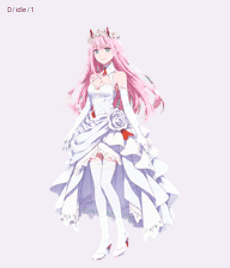

# 02 桌宠 · Zero Two Desktop Pets

Two **Zero Two** sprite packs: **红制服 Q 版 / Red-uniform chibi** and **白礼服（婚纱）版 / White dress**. Each has nine animation states and sixteen look directions.

[Download the latest release](https://github.com/FuXihhy/zero-two-desktop-pet/releases/latest)

| 红制服 Q 版 / Red uniform | 白礼服版 / White dress |
| --- | --- |
|  |  |
| [Sprite sheet](spritesheet.png) · [Manifest](manifest.json) | [Sprite sheet](white-dress/spritesheet.png) · [Manifest](white-dress/manifest.json) |

## 使用 / Usage

在最新 Release 中按需要下载 `02-red-uniform-v1.0.0.zip`（红制服 Q 版）或 `02-white-dress-v1.0.0.zip`（白礼服版）。解压后可直接打开各包内的 `preview.gif` 和 `look-preview.gif` 查看动画。透明 PNG 和 WebP 图集、网格信息及逐行动作定义都在包内，可供支持图集的桌宠或网页组件使用。

Download and extract the release ZIP. Open the GIF previews in a browser or image viewer; use `spritesheet.png` or `spritesheet.webp` with a sprite-sheet renderer. Read `manifest.json` for the grid and animation rows. This repository distributes the artwork and animation assets; it does not contain a standalone desktop application or installer.

## Files

Red-uniform assets are in the repository root. The corresponding white-dress files are in [`white-dress/`](white-dress/). Each variant contains:

- `spritesheet.png`: transparent 1536 × 2288 PNG atlas.
- `spritesheet.webp`: WebP version of the same atlas.
- `manifest.json`: 8 columns × 11 rows; each cell is 192 × 208 pixels.
- `preview.gif`: animation preview.
- `look-preview.gif`: sixteen-direction look preview.
- `reference.png`: original full-body design reference, with its blue generation background.
- `PROMPTS.md`: reference and animation-row generation prompts.
- `SHA256SUMS.txt`: SHA-256 checksums for the included files.

## Animation layout

Rows and columns are zero-indexed. For column `c` and row `r`, crop the rectangle `(192*c, 208*r, 192, 208)` from the atlas. Use only the active frame count for that row; unused cells are padding.

| Row | State | Active frames |
| --- | --- | --- |
| 0 | Idle | 6 |
| 1 | Running right | 8 |
| 2 | Running left | 8 |
| 3 | Waving | 4 |
| 4 | Jumping | 5 |
| 5 | Failed / blocked | 8 |
| 6 | Waiting | 6 |
| 7 | Working | 6 |
| 8 | Review / complete | 6 |
| 9–10 | Look directions | 16 total |

Look directions start at up (0°) and proceed clockwise in 22.5° steps, first across row 9, then across row 10. Animation speed is chosen by the consuming application.

## About the artwork

This is an unofficial fan-art project featuring Zero Two from *DARLING in the FRANXX*. The supplied AI-generated artwork and final animation atlases are preserved without redrawing. Both variants are shared here; Haiyang Huang's personal homepage uses the red-uniform chibi variant as its page companion.
