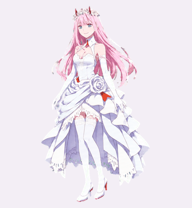

# 02 桌宠 · Zero Two Desktop Pets

红制服 Q 版与白礼服版，各提供 **Codex 兼容版**和 **HD 2× 高清版**。两种尺寸都包含九组动作、十六方向视线，共 73 个有效帧。

[下载 v1.2.0 / Download](https://github.com/FuXihhy/zero-two-desktop-pet/releases/tag/v1.2.0)

| 角色 | Codex 兼容版 | HD 2× 高清版 |
| --- | --- | --- |
| 红制服 Q 版 | [下载 ZIP](https://github.com/FuXihhy/zero-two-desktop-pet/releases/download/v1.2.0/02-red-uniform-codex-v1.2.0.zip) · [素材](spritesheet.png) | [下载 ZIP](https://github.com/FuXihhy/zero-two-desktop-pet/releases/download/v1.2.0/02-red-uniform-hd2x-v1.2.0.zip) · [说明](hd/red-uniform/README.md) |
| 白礼服版 | [下载 ZIP](https://github.com/FuXihhy/zero-two-desktop-pet/releases/download/v1.2.0/02-white-dress-codex-v1.2.0.zip) · [素材](white-dress/spritesheet.png) | [下载 ZIP](https://github.com/FuXihhy/zero-two-desktop-pet/releases/download/v1.2.0/02-white-dress-hd2x-v1.2.0.zip) · [说明](hd/white-dress/README.md) |

## 选择版本 / Choose an edition

| | Codex | HD 2× |
| --- | --- | --- |
| 单帧 / Cell | 192 × 208 px | 384 × 416 px |
| 整张图集 / Atlas | 1536 × 2288 px | 3072 × 4576 px |
| 网格 / Grid | 8 列 × 11 行 | 8 列 × 11 行 |
| 用途 / Use | 当前 Codex 桌宠格式 | 支持自定义帧尺寸的桌宠、网页和游戏 |
| 当前 Codex 可直接加载 | 是 | **否** |

Codex 版保留之前发布的 PNG / WebP 图集原始字节，增加了清楚的版本标记与 `pet.json` 元数据。它的分辨率仍然是每帧 192 × 208；把桌宠显示得更大不会增加图像细节。

HD 版从原始生成的动画条带重新提取、配准并去除背景，宽高各为 Codex 版的两倍。它恢复原始素材中保留的细节，没有将现有 192 × 208 图集直接放大，也没有重新绘制角色。不同动作的原始分辨率并不相同；具体来源、处理比例与校验值记录在各包的 `provenance.json` 中。HD 版不能通过改名或修改版本号变成 Codex 兼容素材。

Both characters have two editions. Choose **Codex** for the current pet format, or **HD 2×** for a renderer that accepts 384 × 416 frames. HD is re-exported from the original generated animation strips, preserving the existing designs and poses. The higher pixel count does not imply that every source frame originally contained the same amount of detail. These are sprite assets, not a standalone desktop application or installer.

## 预览 / Preview

| 红制服 Q 版 / Red uniform | 白礼服版 / White dress |
| --- | --- |
|  |  |
| [同尺寸清晰度对比](hd/red-uniform/comparison.png) | [同尺寸清晰度对比](hd/white-dress/comparison.png) |

GIF 用于查看动作，颜色与透明边缘以包内 PNG / WebP 为准。清晰度对比把旧版放大到与 HD 相同的展示尺寸，避免以不同显示大小比较。

## 接入 / Integration

解压相应 ZIP 后，先打开 `preview.gif` 和 `look-preview.gif` 查看动作。每包的 `manifest.json` 定义了图集尺寸、动作所在行及有效帧数。Codex 包额外提供 `pet.json`；HD 下载包额外提供 73 张透明 PNG 独立帧、处理来源和检验记录，便于接入不使用整张图集的程序。Git 仓库保存图集；独立帧包含在 Release 的 HD ZIP 中，避免在仓库里重复保存同一组像素。

行、列从零开始。设单格宽高为 `W`、`H`，第 `r` 行、第 `c` 列的裁切矩形为 `(W*c, H*r, W, H)`。只播放各行动作的有效帧，剩余 15 格是透明占位；动画速度由使用素材的程序决定。

| 行 / Row | 状态 / State | 有效帧 / Frames |
| --- | --- | --- |
| 0 | Idle | 6 |
| 1 | Running right | 8 |
| 2 | Running left | 8 |
| 3 | Waving | 4 |
| 4 | Jumping | 5 |
| 5 | Failed / blocked | 8 |
| 6 | Waiting | 6 |
| 7 | Working | 6 |
| 8 | Review / complete | 6 |
| 9–10 | Look directions | 16 |

视线方向从正上方 0° 开始，按顺时针每次增加 22.5°，先遍历第 9 行，再遍历第 10 行。`running` 是工作状态，横向跑动对应 `running-right` / `running-left`。

## 文件与打包 / Files and packaging

旧版路径保持有效：红制服 Codex 素材在仓库根目录，白礼服 Codex 素材在 `white-dress/`。高清素材分别在 `hd/red-uniform/` 与 `hd/white-dress/`。

每个发布 ZIP 内含覆盖包内文件的 `SHA256SUMS.txt`，Release 的 `SHA256SUMS.txt` 则用于校验四个 ZIP。仓库中的校验清单只覆盖相应版本的已发布仓库文件，不列出仅在下载包内提供的独立帧。使用 Python 3.9 或更高版本，可从仓库内容重新打包：

```sh
python3 scripts/package_release.py --output-dir /path/to/release-output
```

打包前需将 HD 下载包中的 `frames/` 放入对应的 `hd/red-uniform/` 或 `hd/white-dress/` 目录；仅克隆 Git 仓库不包含这些独立帧。打包命令会核对图集尺寸、动作布局和 HD 独立帧数量，生成四个 ZIP，并重新读取压缩包核对每个文件的 SHA-256。高清素材的完整制作来源以其 `provenance.json` 为准；重新制作需要原始动画条带。

要从原始条带重新制作高清图集，使用 Python 3.11 或更高版本并安装 Pillow：

```sh
python3 scripts/export_hd.py --source-root /path/to/02-pets-migration --output-root /path/to/hd-work --variant both
```

`--source-root` 必须是包含 `B/decoded/`、`D/decoded/`、原配准记录及 `tools/work-pets/scripts/` 的完整原始素材包；这些原始条带及工具没有随本仓库发布。导出目录中的 `B/` 对应红制服，`D/` 对应白礼服；分别合并到仓库的 `hd/red-uniform/` 与 `hd/white-dress/` 后再打包，并保留本仓库的 README。重新导出会更新目标目录中的素材，应使用单独的工作目录。

## 关于作品 / About the artwork

This is an unofficial fan-art project featuring Zero Two from *DARLING in the FRANXX*. The original artwork was AI-generated. This release preserves the existing character designs and animation poses; the HD edition changes extraction and output resolution. The reference images retain their original generation backgrounds. This project is not affiliated with the original creators or OpenAI.
