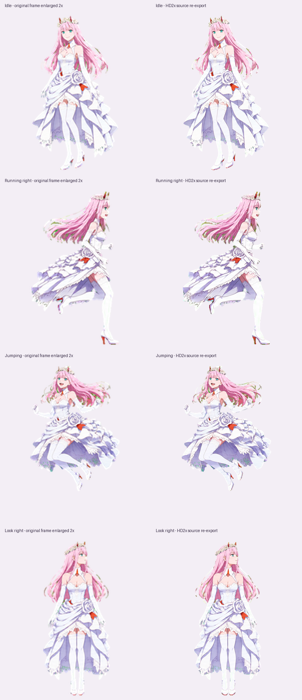

# 02 · 白礼服版 — HD 2×

**通用高清素材，每帧 384 × 416 px。当前 Codex 桌宠不接受这一尺寸。**

[下载 HD 包](https://github.com/FuXihhy/zero-two-desktop-pet/releases/download/v1.2.0/02-white-dress-hd2x-v1.2.0.zip) · [下载 Codex 包](https://github.com/FuXihhy/zero-two-desktop-pet/releases/download/v1.2.0/02-white-dress-codex-v1.2.0.zip) · [完整说明](https://github.com/FuXihhy/zero-two-desktop-pet)

本版从原始动画条带重新提取与配准，保留原有角色、动作及视线方向。宽高是 Codex 版的两倍，整张图集为 3072 × 4576 px、8 列 × 11 行。它没有将已缩小的 Codex 图集直接放大；各动作实际保留的细节受原始条带分辨率约束，处理来源与缩放比例见 `provenance.json`。

## 使用 / Usage

用于支持自定义帧尺寸的桌宠程序、网页或游戏。打开 `preview.gif` 查看动作，打开 `look-preview.gif` 查看十六方向视线。GIF 仅作预览，实际使用透明 PNG / 无损 WebP 图集或 `frames/` 中的独立 PNG。

`manifest.json` 列出每行动作和有效帧数。行、列从零开始，裁切矩形为 `(384*c, 416*r, 384, 416)`。只播放有效帧；15 个空格为透明占位。独立帧共 73 张，位于 HD ZIP 包内 `frames/` 的各状态目录中。Git 仓库保存图集，独立帧请从 Release 下载包获取。

Use this **384 × 416 HD edition** with a renderer that supports custom frame sizes. The atlas is 3072 × 4576 with an 8 × 11 grid. Read `manifest.json` for row definitions and active frame counts, or use the 73 individual transparent PNG frames. Playback timing is controlled by the consuming application. This package does not contain a desktop application or installer.

## 文件 / Files

- `spritesheet.png` / `spritesheet.webp`: transparent atlas; the WebP copy is lossless.
- `frames/`: 73 individual transparent PNG frames, included in the release ZIP.
- `preview.gif` / `look-preview.gif`: motion previews.
- `comparison.png`: old Codex artwork enlarged to the same display size beside HD artwork.
- `manifest.json`: layout, states and compatibility metadata.
- `provenance.json`: source fingerprints and extraction transforms.
- `validation.json`: structural verification results for the export.
- `SHA256SUMS.txt`: file checksums.

This is unofficial fan art of Zero Two from *DARLING in the FRANXX*. The original artwork was AI-generated; this export preserves its character design and animation poses.
