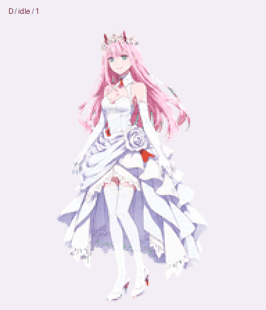

# 02 · 白礼服版 — Codex

白礼服角色的 **Codex 兼容素材**，每帧 192 × 208 px，整张透明图集 1536 × 2288 px，包含九组动作及十六方向视线，共 73 个有效帧。图集 PNG / WebP 保留原先发布的字节。

[下载 Codex 包](https://github.com/FuXihhy/zero-two-desktop-pet/releases/download/v1.2.0/02-white-dress-codex-v1.2.0.zip) · [HD 2× 高清版](https://github.com/FuXihhy/zero-two-desktop-pet/tree/main/hd/white-dress) · [完整说明](https://github.com/FuXihhy/zero-two-desktop-pet)

解压后可打开 `preview.gif` 和 `look-preview.gif` 查看动作。实际使用透明 `spritesheet.png` 或 `spritesheet.webp`；`pet.json` 是 Codex 桌宠元数据，`manifest.json` 说明每行动作、有效帧数和图集布局。GIF 仅作预览，透明边缘以 PNG / WebP 为准。

行、列从零开始，第 `r` 行、第 `c` 列裁切 `(192*c, 208*r, 192, 208)`。只使用 manifest 中的有效帧，透明占位格不应播放。视线方向位于第 9–10 行，从正上方 0° 开始顺时针每次增加 22.5°。

This is the **192 × 208 Codex edition** of the white-dress Zero Two sprite pack. It includes transparent PNG / WebP atlases, animation previews, metadata, the original design reference, prompts and file checksums. Use `manifest.json` to crop frames; the consuming application chooses playback timing. The separate HD edition uses 384 × 416 frames and is not accepted by the current Codex loader. Neither edition includes a desktop application or installer.

The artwork is unofficial fan art of Zero Two from *DARLING in the FRANXX*. The original reference retains its green generation background. This release preserves the existing design, proportions and poses.
